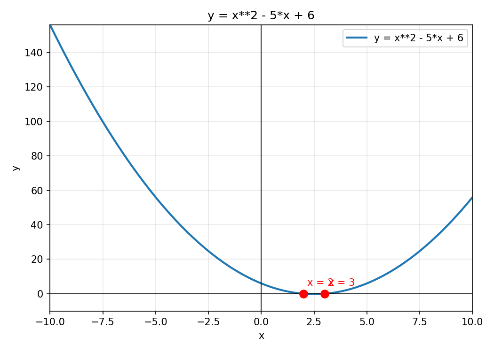

# Equation Visualizer

A desktop app that shows you what a math equation *does* — from basic
arithmetic up to 3D surfaces, systems, and differential equations. Type
any equation or function and it plots it, marks its roots, draws its
derivative and tangent line, shades the area under the curve, and shows
real step-by-step solving. Works fully offline on a PC — no account, no
internet needed after install.



## What it does

- **2D plots** of any function with labeled axes, grid, and the equation
  on the plot — e.g. `y = x^2`, `y = sin(x)`, `y = e^x`, `y = |x|`
- **Roots marked** on the plot: where the curve crosses y = 0, plus the
  solution values of equations like `2x + 3 = 7` and `x^2 - 5x + 6 = 0`
- **Derivative view**: plots f(x) and f'(x) together, plus the tangent
  line at any x you choose
- **Integral view**: shades the area under the curve between two bounds
  and shows the computed area value
- **Step-by-step solving** for linear, quadratic, and cubic equations,
  plus systems — computed from real coefficients (not canned text):
  discriminant, quadratic formula, factored form where it applies
- **Complex roots**: equations with a negative discriminant show their
  complex roots, clearly labeled as complex
- **Interactive sliders**: functions with parameters a, b, c (e.g.
  `y = a*x^2 + b*x + c`) update live as you drag the sliders
- **Multiple functions** on one plot, each with its own color and legend
- **3D surface plots** for two-variable functions, e.g. `z = x^2 + y^2`
- **Systems of equations**: two equations in two unknowns, solved and
  plotted with the intersection point marked
- **Implicit plots**: curves like the circle `x^2 + y^2 = 25` and the
  ellipse `x^2/9 + y^2/4 = 1`
- **Parametric curves**: `x = cos(t), y = sin(t)`, Lissajous figures
- **Polar plots**: `r = 2*sin(3*theta)` rose curves
- **Basic math, exact**: arithmetic and fractions stay exact
  (`1/2 + 1/3 = 5/6`), trigonometry evaluated exactly
  (`sin(pi/3) = sqrt(3)/2`), and **limits** (`sin(x)/x at 0 = 1`)
- **Simple ODEs**: first-order equations like `dy/dx = y` solved with
  sympy and plotted as solution curves for several constants
- **Matrices**: determinant, trace, inverse (when it exists),
  eigenvalues, and `+`, `-`, `*` between two matrices
- **32 one-click presets** covering every area above, so a first-time
  user sees it work instantly
- **Plain-language errors**: invalid input shows a message, never a crash
- **Save plot as PNG** from the app

## How to run

### Windows

```bat
pip install -r requirements.txt
python main.py
```

### Linux / macOS

```bash
pip install -r requirements.txt
python3 main.py
```

Tkinter ships with most Python installs. On Debian/Ubuntu, if it is
missing: `sudo apt install python3-tk`.

## Try it

| Type this | You will see |
|---|---|
| `y = x^2 - 5x + 6` | Parabola with roots x = 2 and x = 3 marked |
| `y = sin(x)` | Sine wave |
| `2x + 3 = 7` | Line for 2x − 4, root x = 2 |
| `x^2 - 5x + 6 = 0` | Same parabola, roots marked, plus Solve steps |
| `y = e^x` | Exponential curve |
| `calc: 1/2 + 1/3` | Exact answer 5/6, decimal 0.8333 |
| `calc: sin(pi/3)` | Exact answer sqrt(3)/2 |
| `limit: sin(x)/x at 0` | Limit = 1 |
| `3d: z = x^2 + y^2` | 3D surface |
| `system: x + y = 5 ; x - y = 1` | Two curves crossing at (3, 2) |
| `implicit: x^2 + y^2 = 25` | Circle of radius 5 |
| `parametric: x = cos(t) ; y = sin(t)` | Unit circle, starts at (1, 0) |
| `polar: r = 2*sin(3*theta)` | Three-petal rose |
| `ode: dy/dx = y` | Solution curves, general solution C1·e^x |
| `matrix: [[1,2],[3,4]]` | Det −2, inverse, eigenvalues |
| `sliders: y = a*x^2 + b*x + c` | Drag a, b, c and watch the parabola move |

Then click **Derivative** (tangent at your chosen x) or **Integral**
(shaded area between your chosen bounds). For `calc:`, `limit:`,
`matrix:` and `ode:` inputs, **Compute** shows the text answer.

## How it works

- `main.py` — Tkinter GUI, the app entry point
- `equation_engine.py` — all math: parsing (sympy), roots, derivative,
  integral, step-by-step solving, and matplotlib plots
- `test_engine.py` — headless verification (see below)

Input accepts `^` for powers, implicit multiplication (`2x`), `ln(x)`,
and `|x|`. Only `x` is the variable; anything else is reported as an
unknown name instead of silently mis-parsing.

## Tests (verified)

```bash
python3 test_engine.py
```

All 115 checks pass: all 32 presets parse/plot/compute, quadratic roots
2 and 3, linear root 2, derivative of x² is 2x with tangent slope 2 at
x = 1, integral of x² from 0 to 3 is 9, a real sine PNG is saved (27,137
bytes), and bad input (`""`, `y =`, `x^^2`, `hello world`) is rejected
with a plain error. v2 checks: slider substitution gives roots 2 and 3,
3D surface f(1, 2) = 5, system solves to (3, 2), complex roots of
x² + 1 are ±i, cubic roots 1, 2 and 3, parametric circle starts at
(1, 0), polar rose r(pi/6) = 2. Breadth checks: 1/2 + 1/3 = 5/6 exactly,
sin(pi/3) = sqrt(3)/2, limits sin(x)/x at 0 = 1 and (x²−1)/(x−1) at 1 = 2,
ODE dy/dx = y gives C1·e^x with the C = 1 curve equal to 1 at x = 0,
matrix [[1,2],[3,4]] has det −2, inverse [[−2, 1], [3/2, −1/2]] and
eigenvalues (5 ± sqrt(33))/2, and a singular matrix is reported as
having no inverse instead of crashing. Sample plots are in
`screenshots/`.

## Known limitations (honest gaps)

- **The GUI window itself was not opened in this Linux VM** (no display
  available headlessly). The math/plotting engine is fully verified via
  `test_engine.py` and `main.py` compiles cleanly, but the Tk window
  has not been clicked through on a real desktop yet — please run
  `python main.py` on a PC with a display to confirm the window.

## Still not supported (not claimed, not faked)

- **Partial differential equations (PDEs)** and systems of ODEs — only
  single first-order ODEs that sympy's `dsolve` can actually solve.
  Anything else shows an error, not an invented solution.
- **Matrix decompositions** (LU, QR, SVD) and matrix calculus.
- **3D implicit surfaces** (e.g. a sphere as x² + y² + z² = 25) — 3D
  covers explicit surfaces z = f(x, y) only.
- **Statistics, probability, and number theory** (distributions,
  hypothesis tests, prime factorization beyond sympy's basic factoring).
- **Multi-variable calculus** beyond 3D surfaces: no partial-derivative
  or double-integral views yet.
- **Step-by-step working for limits, ODEs, and matrices** — those show
  the verified answer, not a full worked derivation.
- The default x-range is −10 to 10 (adjustable in the app); very large
  values can make the y-axis hard to read.

## License

MIT — see [LICENSE](LICENSE).
